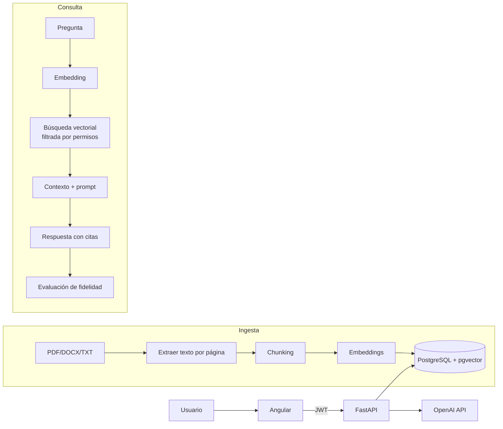

# Enterprise AI Knowledge Assistant

Asistente empresarial con **RAG (Retrieval-Augmented Generation)**: una empresa sube sus documentos (PDF, DOCX, TXT) y los empleados hacen preguntas en lenguaje natural. La IA responde **solo** con la información recuperada de esos documentos y **cita las fuentes** (documento y página).

> 🚧 Proyecto en construcción por fases. Ver [Hoja de ruta](#hoja-de-ruta).

## Stack

| Capa | Tecnología |
|---|---|
| Frontend | Angular |
| API | Python · FastAPI |
| Base de datos | PostgreSQL 16 + **pgvector** |
| IA | OpenAI API (chat + embeddings) |
| Infra | Docker Compose |

## Arquitectura



### Flujo de una pregunta

1. El usuario pregunta: *«¿Cuántos días de vacaciones me corresponden?»*
2. Se calcula el embedding de la pregunta.
3. pgvector devuelve los fragmentos más similares **solo de documentos que el usuario tiene permiso para ver**.
4. Los fragmentos se envían al modelo junto con instrucciones de responder únicamente con ese contexto.
5. La respuesta incluye citas `[documento, página]` y una puntuación de fidelidad (detección de alucinaciones).

## Hoja de ruta

- [x] **Fase 0 – Fundamentos**: estructura del repo, Docker Compose, PostgreSQL + pgvector, FastAPI con `/api/health`.
- [x] **Fase 1 – Autenticación**: modelo de usuario, Alembic, registro/login con JWT, hash bcrypt, rol admin/user, tests.
- [ ] **Fase 2 – Ingesta de documentos**: subida (admin), extracción PDF/DOCX/TXT por página, chunking, embeddings.
- [ ] **Fase 3 – Búsqueda semántica**: consulta vectorial con pgvector (índice HNSW), endpoint de búsqueda.
- [ ] **Fase 4 – Chat RAG**: conversaciones con historial, prompt con contexto, respuestas con citas.
- [ ] **Fase 5 – Roles y permisos**: roles/departamentos, filtrado de documentos por permiso en la recuperación.
- [ ] **Fase 6 – Evaluación**: verificación de fidelidad (LLM-as-judge), dataset de evaluación, métricas.
- [ ] **Fase 7 – Frontend Angular**: login, chat, panel de administración.
- [ ] **Fase 8 – Calidad**: tests, CI con GitHub Actions, despliegue.

## Puesta en marcha

### Requisitos

- Docker Desktop
- Python 3.12+ (para desarrollo local sin Docker)
- Node.js 20+ (para el frontend, fase 7)

### Con Docker

```bash
cp .env.example .env      # y rellena OPENAI_API_KEY
docker compose up --build
```

Abre http://localhost:8000/docs (Swagger) y prueba `GET /api/health`:

```json
{ "status": "ok", "database": "ok", "pgvector": "0.8.0" }
```

### Backend en local (BD en Docker)

```bash
docker compose up -d db
cd backend
python -m venv .venv
.venv\Scripts\activate          # Windows  (Linux/Mac: source .venv/bin/activate)
pip install -r requirements-dev.txt
alembic upgrade head            # crea las tablas
uvicorn app.main:app --reload
```

### Crear un administrador

El registro público (`POST /api/auth/register`) siempre crea usuarios con rol `user`. Los administradores se crean por consola:

```bash
python -m app.scripts.create_admin --email admin@empresa.com --name "Admin"
# o con Docker:
docker compose exec backend python -m app.scripts.create_admin --email admin@empresa.com --name "Admin"
```

### Tests

```bash
cd backend
pytest -q
```

## API (hasta ahora)

| Método | Ruta | Auth | Descripción |
|---|---|---|---|
| GET | `/api/health` | – | Estado de la API, la BD y pgvector |
| POST | `/api/auth/register` | – | Registro (rol `user`) |
| POST | `/api/auth/login` | – | Login (form `username`=email, `password`) → JWT |
| GET | `/api/auth/me` | Bearer | Usuario autenticado |

En Swagger (`/docs`) usa el botón **Authorize** para hacer login y probar las rutas protegidas.

## Estructura

```
.
├── backend/
│   ├── app/
│   │   ├── api/          # Routers de FastAPI y dependencias (auth, roles)
│   │   ├── core/         # Configuración, seguridad (bcrypt, JWT)
│   │   ├── db/           # Conexión a la BD
│   │   ├── models/       # Modelos ORM (SQLAlchemy)
│   │   ├── schemas/      # Esquemas Pydantic (entrada/salida de la API)
│   │   ├── scripts/      # Utilidades de consola (create_admin)
│   │   └── main.py
│   ├── migrations/       # Migraciones Alembic
│   ├── tests/
│   ├── Dockerfile
│   └── requirements.txt
├── db/init/              # SQL de inicialización (activa pgvector)
├── docker-compose.yml
└── .env.example
```
